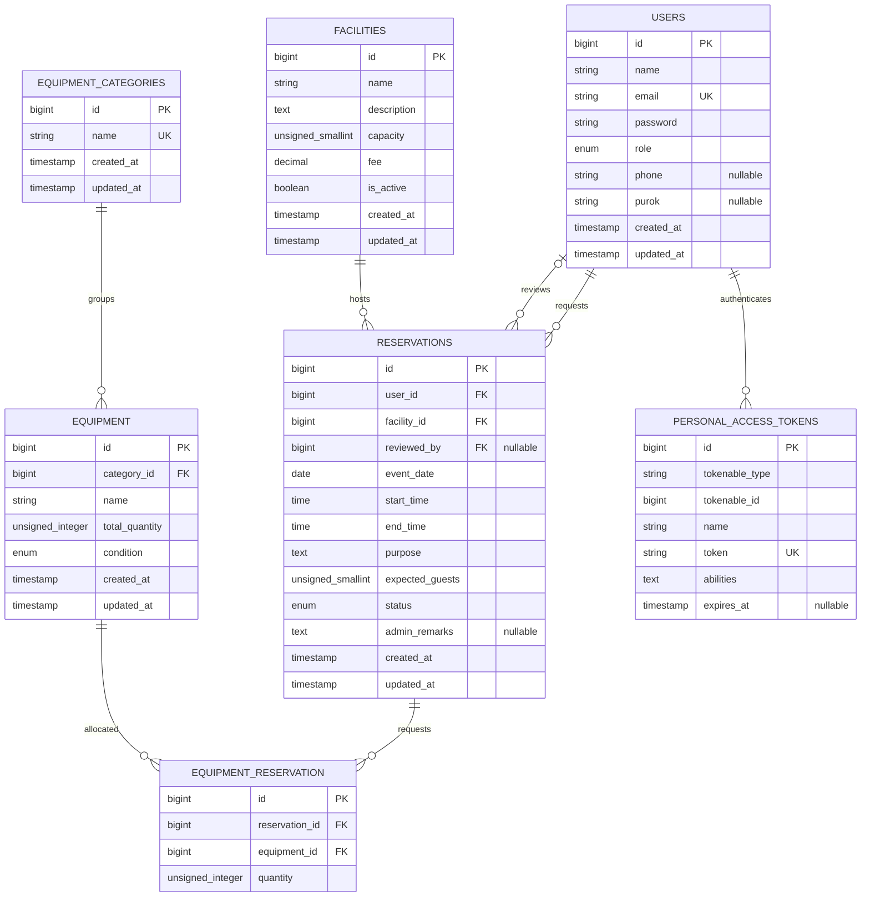

# BarangayBook Entity Relationship Diagram

`reviewed_by` is nullable until an administrator approves or rejects a reservation. The equipment pivot has a unique `(reservation_id, equipment_id)` pair and cascades when its reservation is deleted. Facility, equipment, and user records referenced by reservations are restricted from deletion to preserve booking history. Laravel also creates password-reset, cache, job, and migration tables for framework operations; those are omitted from this domain diagram.
